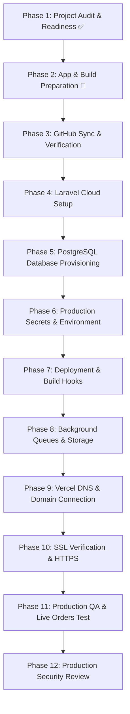

# SABAYRA SaaS — Production Deployment Roadmap

**Project:** SABAYRA SaaS Platform  
**Target Date:** November 2026  
**Destination:** `https://sabayra.site` via Laravel Cloud & Vercel DNS  

---

## Phase Overview

---

## Step-by-Step Execution Plan

### Phase 1: Complete Project Audit (Current Phase)
- [x] Inspect Laravel version, runtime requirements, and lockfiles.
- [x] Verify multi-tenant architecture, route groups, and database connections.
- [x] Verify full test suite passing (97/97 tests passed).
- [x] Document audit, requirements, and roadmap.

### Phase 2: Prepare Application for Cloud
- [ ] Install `laravel/cloud-cli` in project: `composer require --dev laravel/cloud-cli`.
- [ ] Configure `trustProxies(at: '*')` and force HTTPS in production.
- [ ] Verify Vite build asset manifest in `public/build/manifest.json`.

### Phase 3: GitHub Synchronization
- [ ] Ensure all preparation commits are pushed to `main` at `https://github.com/nouchansokkhea-jpg/sabayra-pos.git`.
- [ ] Verify working tree is clean.

### Phase 4: Laravel Cloud Infrastructure
- [ ] Connect Laravel Cloud account to GitHub repository `nouchansokkhea-jpg/sabayra-pos`.
- [ ] Select branch `main`.
- [ ] Choose Asia Pacific region (Singapore `ap-southeast-1` for lowest Cambodian latency).
- [ ] Select PHP 8.3 / 8.4 runtime with standard web server.

### Phase 5: Production PostgreSQL Database
- [ ] Select persistent PostgreSQL 16 cluster on Laravel Cloud or link production Supabase instance.
- [ ] Run initial zero-downtime migration: `php artisan migrate --force`.
- [ ] Verify UUID extension and tables exist.

### Phase 6: Environment Configuration
- [ ] Inject production environment variables via Laravel Cloud Secrets / Environment Settings.
- [ ] Verify `APP_KEY`, `APP_ENV=production`, `APP_DEBUG=false`, and `APP_URL=https://sabayra.site`.

### Phase 7: Automated Build & Deploy
- [ ] Configure build script: `composer install --no-dev --optimize-autoloader && npm ci && npm run build`.
- [ ] Configure deploy script: `php artisan migrate --force && php artisan config:cache && php artisan route:cache && php artisan view:cache`.

### Phase 8: Queues, Scheduler, and Storage
- [ ] Attach persistent Cloud Object Storage bucket (or verify Supabase Storage).
- [ ] Enable Laravel Cloud Scheduler for recurring tasks.

### Phase 9: Vercel DNS Configuration
- [ ] Add `sabayra.site` and `www.sabayra.site` in Laravel Cloud Domains dashboard.
- [ ] Retrieve DNS records (A/CNAME).
- [ ] Open Vercel DNS manager and configure matching records without touching existing email MX/TXT records.

### Phase 10: SSL & HTTPS Verification
- [ ] Verify automatic Let's Encrypt SSL certificate issuance.
- [ ] Verify `https://sabayra.site` loads securely with padlock icon.
- [ ] Verify `https://www.sabayra.site` redirects to canonical apex.

### Phase 11: Production QA & Acceptance
- [ ] Test customer ordering on live storefront.
- [ ] Test merchant POS, Live Orders feed, and KDS bump.
- [ ] Test QR code generation for tables and storefront.
- [ ] Verify multi-tenant data isolation.

### Phase 12: Production Security Review & Sign-Off
- [ ] Confirm `APP_DEBUG=false` and no debug traces exposed.
- [ ] Confirm database backups scheduled.
- [ ] Deliver final deployment report.
